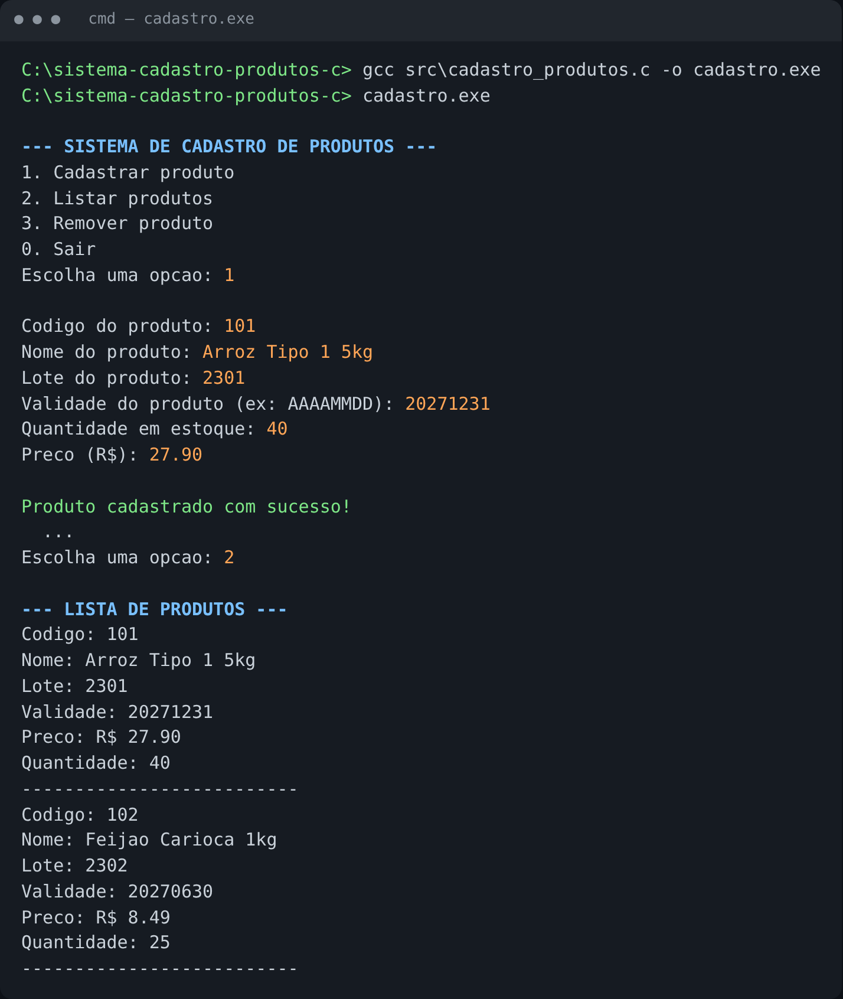

# 📦 Sistema de Cadastro de Produtos em C


Sistema de terminal para **cadastro e gerenciamento de produtos**, desenvolvido em linguagem C como projeto prático do 2º semestre de **Engenharia de Software (UDF)**, em um desafio colaborativo de Git/GitHub.

---

## 🧭 Visão geral e contexto

Comércios e pequenas empresas precisam controlar o que entra e sai do estoque: código, nome, lote, validade, quantidade e preço de cada item. Muitas vezes esse controle fica em cadernos ou planilhas soltas.

Este projeto resolve esse problema de forma simples, com um menu interativo no terminal que permite:

| Opção | Funcionalidade |
|:-----:|----------------|
| `1` | **Cadastrar** um produto (código, nome, lote, validade, quantidade e preço) |
| `2` | **Listar** todos os produtos cadastrados |
| `3` | **Remover** um produto pelo código |
| `0` | **Sair** do sistema |

**Conceitos praticados:** `struct`, vetores de estruturas, laços de repetição (`do-while`, `for`), estruturas condicionais, entrada e saída formatada (`scanf`/`printf`) e remoção com deslocamento de elementos no vetor.

---

## 🛠️ Tecnologias utilizadas

- **Linguagem C** (padrão C99)
- **GCC**, compilador GNU (no Windows via [MinGW-w64](https://www.mingw-w64.org/) / [MSYS2](https://www.msys2.org/))
- Bibliotecas padrão: `stdio.h`, `string.h`
- **Git e GitHub** para versionamento e trabalho colaborativo

---

## 📁 Estrutura do projeto

```
sistema-cadastro-produtos-c/
├── src/
│   └── cadastro_produtos.c   ← código-fonte do sistema
├── docs/
│   └── demonstracao.png      ← captura da execução
├── .gitignore
├── LICENSE
└── README.md
```

---

## ▶️ Como executar localmente

**Pré-requisito:** ter o compilador GCC instalado. Para verificar, rode `gcc --version`.

```bash
# 1. Clonar o repositório
git clone https://github.com/paodilas/sistema-cadastro-produtos-c.git
cd sistema-cadastro-produtos-c

# 2. Compilar
gcc src/cadastro_produtos.c -o cadastro

# 3. Executar
./cadastro          # Linux / macOS
cadastro.exe        # Windows (cmd)
```

> Não há dependências externas, apenas a biblioteca padrão do C.

---

## 🖥️ Demonstração



Exemplo de uso:

```text
--- SISTEMA DE CADASTRO DE PRODUTOS ---
1. Cadastrar produto
2. Listar produtos
3. Remover produto
0. Sair
Escolha uma opcao: 3

Digite o codigo do produto que deseja remover: 101

Produto removido com sucesso!
```

---

## 🔭 Próximos passos

- [ ] Salvar os produtos em arquivo (`.txt` ou `.csv`) para não perder os dados ao fechar
- [ ] Editar um produto já cadastrado
- [ ] Buscar produto por nome ou código
- [ ] Alertar sobre produtos próximos do vencimento
- [ ] Validar entradas (preço negativo, código duplicado)

---

## 👥 Colaboração

Projeto desenvolvido em grupo no desafio colaborativo de Git. Repositório original: [adrianoabc786-prog/desafio-colaborativo-git](https://github.com/adrianoabc786-prog/desafio-colaborativo-git).

## 📄 Licença

Distribuído sob a licença **MIT**. Veja o arquivo [LICENSE](LICENSE).
